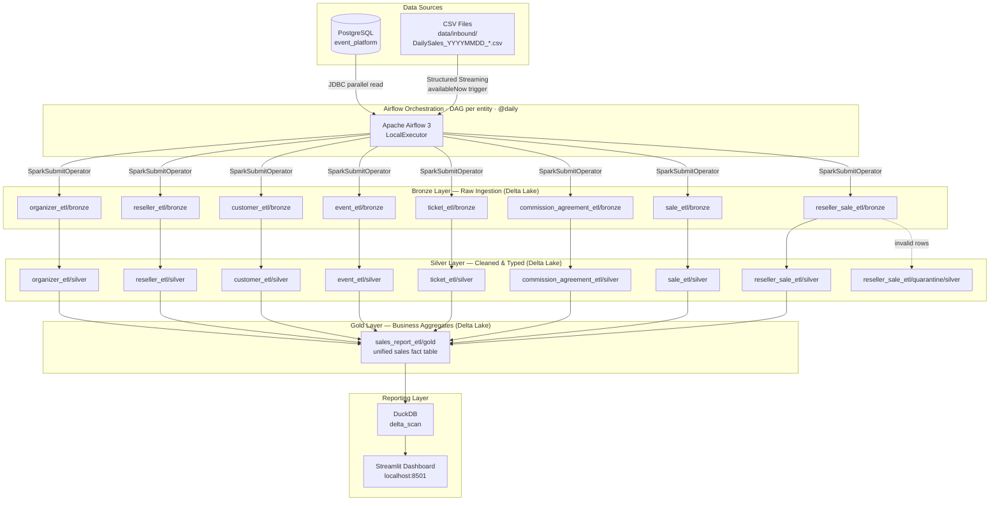
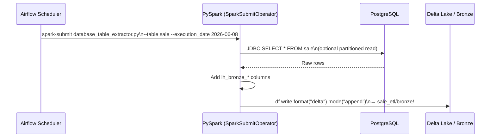
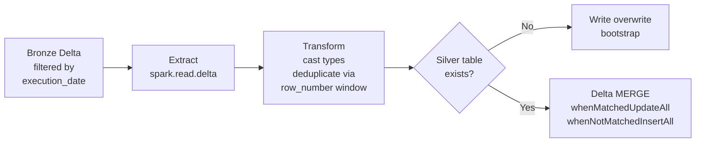
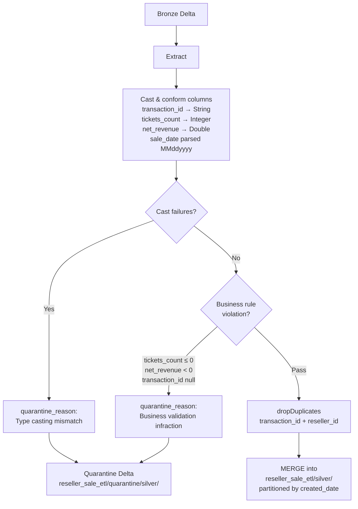
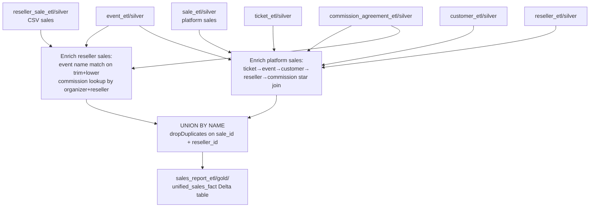
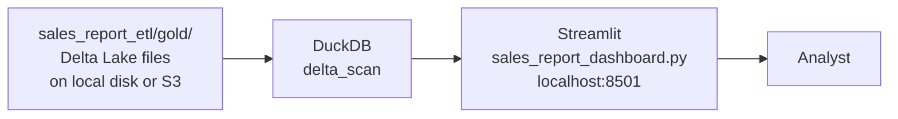
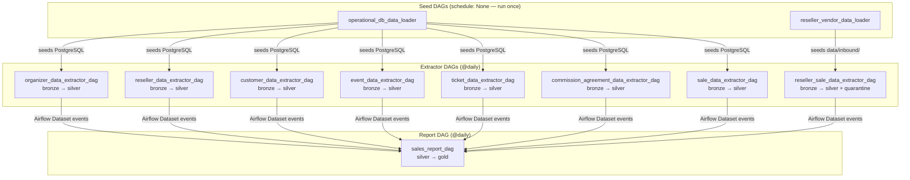

# Data Flow: PostgreSQL → Medallion Lakehouse

This document describes how data moves from the operational PostgreSQL database and reseller CSV files through the Bronze → Silver → Gold Delta Lake layers and into the Streamlit reporting dashboard.

---

## 1. End-to-End Overview



---

## 2. Source Systems

### 2a. Operational PostgreSQL (`event_platform`)

Seven tables are extracted daily:

| Table | Primary Key | Description |
|---|---|---|
| `organizer` | `organizer_id` | Event organizers |
| `reseller` | `reseller_id` | Ticket reseller companies |
| `customer` | `customer_id` | End customers |
| `event` | `event_id` | Events created by organizers |
| `ticket` | `ticket_id` | Ticket types per event |
| `commission_agreement` | `agreement_id` | Organizer–reseller commission contracts |
| `sale` | `sale_id` | Platform-side ticket sales |

### 2b. Reseller CSV Files (`data/inbound/`)

Vendor daily sales reports dropped as CSV files following the naming convention:

```
DailySales_YYYYMMDD_<reseller_id>.csv
```

The `reseller_id` and `sale_date` are parsed directly from the filename via regex.

---

## 3. Bronze Layer — Raw Ingestion

**Purpose:** Land source data as-is into Delta Lake with lineage metadata. No business transformations.

### 3a. Database tables → Bronze (JDBC batch extract)

**Job:** `src/jobs/core/bronze/database_table_extractor.py` (`JDBCDatabaseExtractor`)   
**Write mode:** `append` with `mergeSchema=true`

Each table is read in full via JDBC (optionally parallelised with partition column + bounds) and three lineage columns are appended before writing:

| Column added | Value |
|---|---|
| `lh_bronze_execution_date` | Airflow logical date (`{{ ds }}`) |
| `lh_bronze_inserted_timestamp` | `current_timestamp()` at write time |
| `lh_bronze_source_database_table` | Source table name string |



### 3b. CSV files → Bronze (Spark Structured Streaming)

**Job:** `src/jobs/reseller_sale_etl/bronze/incremental_reseller_data_extractor.py` (`IncrementalResellerDataExtractor`)  
**Write mode:** Streaming append, partitioned by `lh_bronze_execution_date`, `trigger=availableNow`

The job enforces a strict schema contract (`DATA_CONTRACT_SCHEMA`) on ingest so malformed files fail fast. Column names are sanitised (spaces → underscores) and additional fields extracted:

| Column added | Source |
|---|---|
| `reseller_id` | Regex on `input_file_name()` |
| `sale_date` | Regex on `input_file_name()` |
| `lh_bronze_execution_date` | Airflow execution date |
| `lh_bronze_inserted_timestamp` | `current_timestamp()` |

Streaming checkpoints are stored at `reseller_sale_etl/_checkpoints/` to enable exactly-once semantics across re-runs.

---

## 4. Silver Layer — Cleansed & Typed

**Purpose:** Enforce types, deduplicate, rename to business-friendly column names, and upsert idempotently. The Silver layer is the **system of record** for all downstream consumers.

### 4a. Pattern: DB-sourced entities (organizer, reseller, customer, event, ticket, commission_agreement, sale)

All seven share the same structure via `BaseDataPipeline`:



**Deduplication:** a `Window.partitionBy(pk).orderBy(lh_bronze_inserted_timestamp DESC)` picks the latest row per primary key within the execution partition.

**Upsert key per entity:**

| Entity | Merge key              |
|---|------------------------|
| organizer | `organizer_id`         |
| reseller | `reseller_id`          |
| customer | `customer_id`          |
| event | `event_id`             |
| ticket | `ticket_id`            |
| commission_agreement | `agreement_id`         |
| sale | `sale_id, reseller_id` |

Two Silver lineage columns are added:

| Column | Value |
|---|---|
| `lh_silver_execution_date` | Airflow logical date |
| `lh_silver_inserted_timestamp` | `current_timestamp()` at write time |

### 4b. Reseller CSV → Silver (with quarantine)

**Job:** `src/jobs/reseller_sale_etl/silver/reseller_data_bronze_to_silver_transformer.py`

This pipeline adds a **quarantine branch** absent from the DB-sourced pipelines:



---

## 5. Gold Layer — Business Aggregates

**Purpose:** Produce a single denormalised **unified sales fact table** combining platform sales and CSV reseller sales for BI consumption.

**Job:** `src/jobs/sales_report_etl/gold/sales_report_etl.py` (`SalesReportETL`)  
**DAG:** `sales_report_dag` (runs after all Silver DAGs complete)

### 5a. Join graph



### 5b. Output schema

| Column | Source                                           |
|---|--------------------------------------------------|
| `sale_id` | `sale.sale_id` / `reseller_sale.transaction_id`  |
| `event_name` | event Silver                                     |
| `event_type` | event Silver                                     |
| `event_region` | event Silver                                     |
| `ticket_category` | ticket Silver (null for CSV path)                |
| `tickets_count` | `sale.quantity` / `reseller_sale.tickets_count`  |
| `total_amount` | `sale.total_amount` / `reseller_sale.net_revenue` |
| `commission_amount` | pre-computed                                     |
| `commission_rate_applied` | commission_agreement Silver                      |
| `sales_channel` | `sale.channel` / `reseller_sale.sales_channel`   |
| `customer_first_name` | customer Silver / CSV field                      |
| `customer_last_name` | customer Silver / CSV field                      |
| `reseller_id` | from source                                      |
| `sale_date` | from source                                      |
| `reseller_location` | reseller Silver country / CSV office_location    |
| `source` | `"platform"` or `"csv_import"`                   |

---

## 6. Reporting Layer

**No Spark required.** The Streamlit dashboard reads Gold Delta files directly using DuckDB's `delta_scan()` function — a lightweight columnar query engine that understands the Delta transaction log.



Dashboard tabs powered by SQL queries over the Gold table:

| Tab | Query pattern |
|---|---|
| Weekly Channel Trends | `SUM(total_amount) GROUP BY week, sales_channel` |
| YoY February Comparison | `SUM(total_amount) GROUP BY year WHERE month = 2` |
| Commission Correlation | Commission rate vs. revenue scatter |
| Regional Popularity | Sales by `event_region` |

---

## 7. Lakehouse Directory Structure

```
data/lakehouse/                         ← DYNACONF_STORAGE__BASE_PATH
│
├── organizer_etl/
│   ├── bronze/                         ← Delta table (append)
│   ├── silver/                         ← Delta table (MERGE upsert)
│   └── _checkpoints/
│
├── reseller_etl/          bronze/ silver/
├── customer_etl/          bronze/ silver/
├── event_etl/             bronze/ silver/
├── ticket_etl/            bronze/ silver/
├── commission_agreement_etl/ bronze/ silver/
├── sale_etl/              bronze/ silver/
│
├── reseller_sale_etl/
│   ├── bronze/                         ← Delta table (streaming append)
│   ├── silver/                         ← Delta table (MERGE, partitioned by created_date)
│   ├── quarantine/
│   │   └── silver/                     ← Rejected rows with quarantine_reason
│   └── _checkpoints/
│       └── reseller_sale_etl_to_bronze/
│
└── sales_report_etl/
    └── gold/                           ← Unified sales fact Delta table (MERGE)
```

On AWS, `data/lakehouse/` maps to `s3a://YOUR-BUCKET/lakehouse/` — all paths are resolved by `LakehousePathResolver` and support both local and S3 URIs transparently.

---

## 8. Airflow DAG Dependency Map

Each entity DAG runs independently on a `@daily` schedule. DAGs publish an **Airflow Dataset** on success; downstream DAGs may consume those events.



### Within each extractor DAG

Every extractor DAG follows the same two-task pattern:

```
start_gate → bronze_ingest_<entity> → silver_transform_<entity> → end_gate
```

Both Spark steps use `SparkSubmitOperator` with `conn_id=spark_local` and receive `--execution_date {{ ds }}` so all runs are idempotent and partition-safe.

---

## 9. Config & Path Resolution

All paths and connection IDs are resolved at runtime via Dynaconf:

| Config key | Default (local) | Override (production) |
|---|---|---|
| `storage.base_path` | `data/lakehouse` | `s3a://bucket/lakehouse` |
| `storage.inbound_path` | `data/inbound` | `s3a://bucket/inbound` |
| `airflow.spark_conn_id` | `spark_local` | EMR cluster URI |
| `airflow.postgres_conn_id` | `postgres_event_platform` | RDS endpoint |

`LakehousePathResolver.resolve(layer, etl_name)` builds all three path variants (target, checkpoint, quarantine) from a single base path, making every job portable between local disk and S3 with zero code changes.
