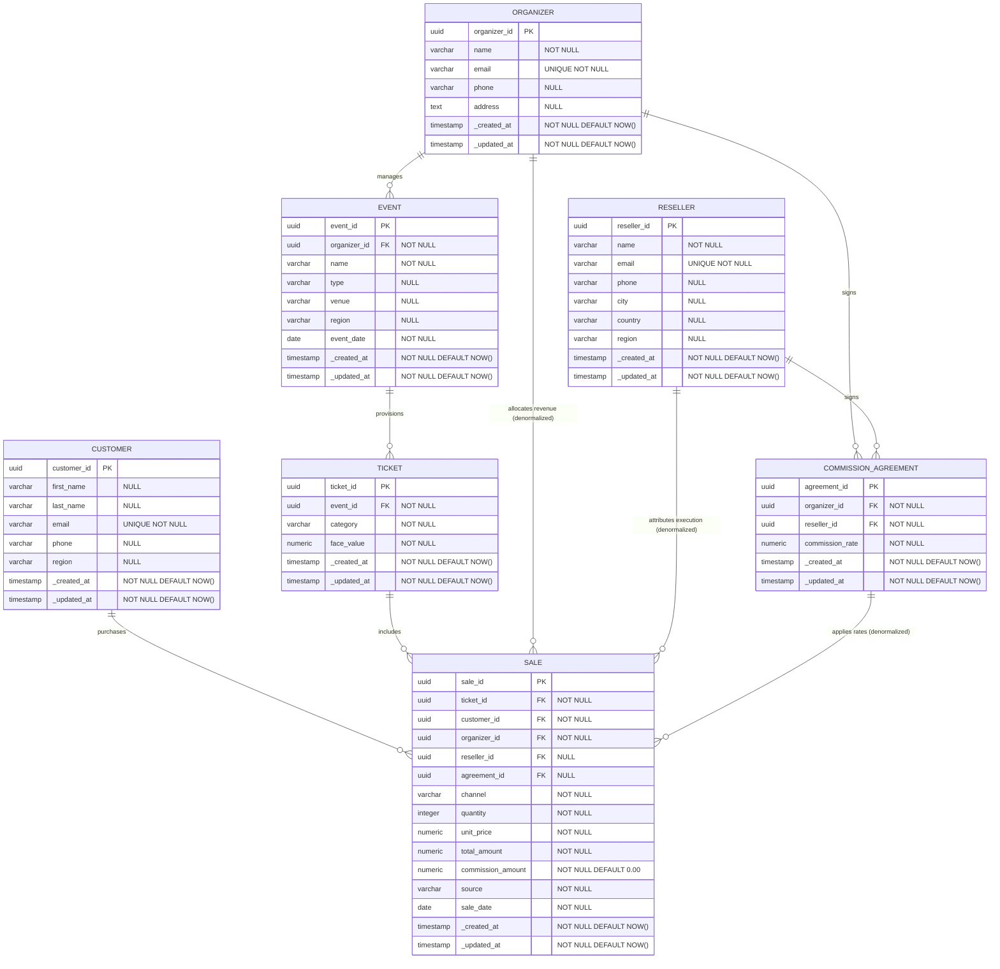

# Entity Relationship Diagram — Operational Database

> Database: `event_platform` (PostgreSQL)  
> All tables carry `_created_at` and `_updated_at` audit timestamps managed by the `set_updated_at()` trigger function.

---

## Relationship Summary

| Relationship | Type | Description |
|---|---|---|
| `ORGANIZER` → `EVENT` | One-to-many | An organizer runs zero or more events |
| `ORGANIZER` → `COMMISSION_AGREEMENT` | One-to-many | An organizer may have agreements with multiple resellers |
| `RESELLER` → `COMMISSION_AGREEMENT` | One-to-many | A reseller may have agreements with multiple organizers |
| `EVENT` → `TICKET` | One-to-many | An event offers one or more ticket categories |
| `TICKET` → `SALE` | One-to-many | A ticket type can be sold multiple times |
| `CUSTOMER` → `SALE` | One-to-many | A customer can make multiple purchases |
| `ORGANIZER` → `SALE` | One-to-many | Denormalized reference — identifies which organizer's event was sold |
| `RESELLER` → `SALE` | One-to-many | Denormalized reference — identifies the reseller who facilitated the sale |
| `COMMISSION_AGREEMENT` → `SALE` | One-to-many | Links the applicable commission agreement to each reseller sale |
